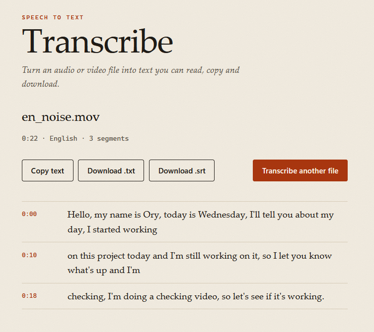
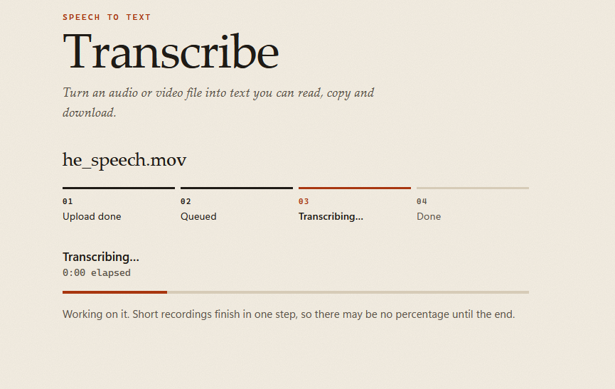
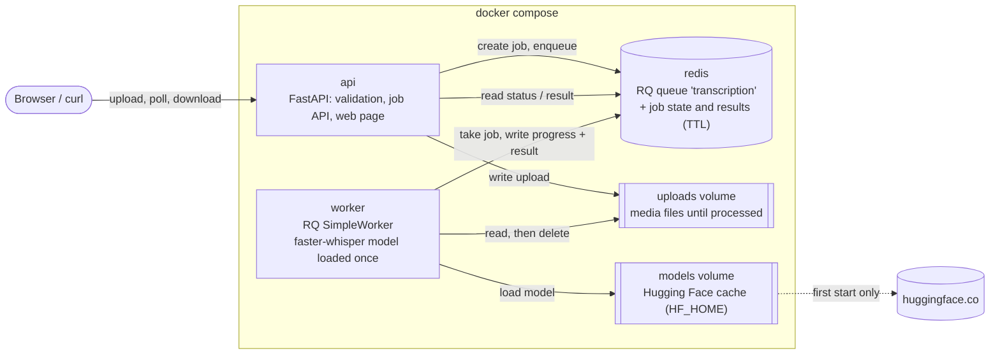
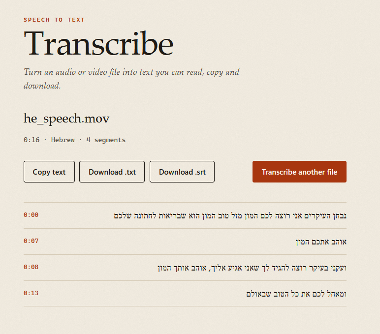

# Transcription Service

[](https://github.com/orischnieder/transcription-service/actions/workflows/ci.yml)

Upload an audio or video file and get a timestamped transcript, produced by an open-source Whisper model
from Hugging Face running on your own machine. A small web page and a JSON API sit in front of a
background worker, so the page stays responsive while the model works.



Full decision log with alternatives and measurements: [NOTES.md](NOTES.md).

---

## Quick start

**Prerequisites:** Docker with Docker Compose v2 (Docker Desktop on Windows/macOS). Nothing else: Python,
ffmpeg and Redis run inside the containers.

```bash
git clone https://github.com/orischnieder/transcription-service.git
cd transcription-service
docker compose up --build
```

Open **http://localhost:8000** and drop in an audio or video file.

- The first start downloads the model `Systran/faster-whisper-small` (~464 MB) into the `models` Docker
  volume. This happens once; later starts load it from the volume in a few seconds. The worker only takes jobs
  after the model is loaded, so the very first job waits for the download.
- No `.env` file is needed; every setting has a default (see [Configuration](#configuration)).
- Stop with `Ctrl+C`, or `docker compose down` (add `-v` to also delete the downloaded model and any
  pending uploads).

---

## How to use it

### Web page

1. Drop a file on the page or click **Choose a file**. Accepted formats, the size limit and the length
   limit are shown on the page. Optionally pick the spoken language (default: detect automatically).
2. Click **Transcribe**. The page shows the stages *Uploading → Queued → Transcribing → Done*, the upload
   percentage, then the transcription percentage and elapsed time.
3. Read the transcript with timestamps, **Copy text**, or download it as **.txt** or **.srt** (subtitles).



Errors (wrong file type, file too long, server busy, …) are shown in plain language with a **Try again**
button. The page works with the keyboard only and on a phone-width screen, and right-to-left languages
(Hebrew, Arabic) are displayed right-to-left.

### API

Interactive docs (OpenAPI): **http://localhost:8000/docs**

| Method and path | What it does |
|---|---|
| `GET /health` | `200 {"status":"ok","redis":"ok"}`, or `503` if Redis is unreachable |
| `GET /api/limits` | Allowed extensions, max size (MB), max duration (s), supported language codes |
| `POST /api/jobs` | Multipart upload: `file`, optional `language` (e.g. `en`; empty = auto). Returns `202` with the job and a `Location` header |
| `GET /api/jobs/{id}` | Job status (`queued`, `processing`, `done`, `failed`), `progress` 0–100, and `result` when done |
| `GET /api/jobs/{id}/transcript.txt` | Transcript, one segment per line (`409` until done) |
| `GET /api/jobs/{id}/transcript.srt` | Subtitles (`409` until done) |

Every error has the same shape, for example:

```json
{ "error": { "code": "media_too_long", "message": "The audio or video is longer than the 60 minute limit." } }
```

Example with curl:

```bash
# 1. Upload (prints the job, including its "id")
curl -F "file=@interview.mp3" -F "language=en" http://localhost:8000/api/jobs

# 2. Poll until "status" is "done" (or "failed")
curl http://localhost:8000/api/jobs/<id>

# 3. Download the subtitles
curl -OJ http://localhost:8000/api/jobs/<id>/transcript.srt
```

---

## Architecture



**Job lifecycle:** `queued` → `processing` → `done` | `failed`

1. The API validates the upload, stores the file as `{job_id}.{ext}`, records the job as `queued` in Redis
   and enqueues it. It answers `202` immediately.
2. The worker marks the job `processing`, transcribes it and writes progress (at most once per second).
3. It stores the result and marks the job `done`, or records an error code and marks it `failed`.
   Either way the media file is deleted.
4. Job state and results expire 24 hours after the job's last change.

**Why a separate worker?** Transcription is slow, CPU-heavy work: an hour of audio takes about 10 minutes
on a laptop CPU. If it ran inside the web server, the server would be busy and could stop answering other
users, health checks and progress requests. Putting jobs in a queue and running the model in its own
process keeps the API responsive (an upload returns as soon as the file is stored and checked; status
requests take milliseconds), lets the model stay loaded between jobs, and lets the worker restart
without touching the API.

---

## Key decisions

Each decision with its full reasoning and measurements is in [NOTES.md](NOTES.md).

| Decision | Why | Main alternative |
|---|---|---|
| **FastAPI** + Pydantic | Request validation, typed responses and OpenAPI docs at `/docs` out of the box | Flask (validation and docs by hand) |
| **faster-whisper** with **`Systran/faster-whisper-small`** from Hugging Face (CTranslate2 conversion of `openai/whisper-small`, MIT) | Fast on CPU with `int8`, no PyTorch in the image; the model is still a Hugging Face model, loaded by repo id | `transformers` pipeline (needs PyTorch, slower on CPU) |
| **small** rather than **base** | Benchmark below: small is ~3× slower but still ~6× faster than real time. Larger Whisper models are generally reported to hold up better on accents, noise and non-English audio (general knowledge, not measured here) | `faster-whisper-base` (faster) |
| **Engine behind a `TranscriptionEngine` Protocol**, chosen by `ENGINE` | The rest of the code only knows `transcribe(path, language, on_progress)`. Tests use `FakeEngine`. The Hebrew model `ivrit-ai/whisper-large-v3-turbo-ct2` loaded with no code change, only `WHISPER_MODEL` | Calling faster-whisper directly from the task |
| **Redis + RQ** with **`SimpleWorker`** | Simple queue with timeouts; `SimpleWorker` runs jobs in its own process, so the model is loaded once, not per job | Celery (more setup); a forking worker (reloads the model for each job) |
| **Validation before queueing**: language → extension → size (counted while copying) → empty → `ffprobe` (must have an audio stream, read duration) → duration | Cheap checks first; the file's real content is checked, not its name or `Content-Type`; any failure deletes the file | Trusting the extension; failing later inside the worker |
| **Polling** `GET /api/jobs/{id}` every 1.5 s | Simple and robust behind any proxy; progress changes slowly anyway | Server-sent events or WebSockets |
| **No-build UI**: one HTML page, vanilla JS and CSS, served by FastAPI | Works offline / air-gapped, nothing to compile, no external assets | React or Vue with a build step |

**Model benchmark** (`samples/physicsworks.wav`, 203 s English lecture; Intel Core i7-1255U laptop, CPU,
`int8`, VAD off, Docker with 12 CPUs; second run of each model):

| Model | Download | Load (cached) | Transcription | Real-time factor |
|---|---|---|---|---|
| `Systran/faster-whisper-base` | 142 MB | 0.7 s | 12.1 s | 0.06 |
| `Systran/faster-whisper-small` | 464 MB | 1.8 s | 35.1 s | 0.17 |

Real-time factor = transcription time ÷ audio length (below 1 is faster than real time). The two
transcripts were 98% identical on this clean recording. With the VAD filter on (now the default), small
took 29.5 s instead of 31.3 s in a same-process comparison.

**Reproducing it.** The samples are the test files of the faster-whisper project
([SYSTRAN/faster-whisper, `tests/data`](https://github.com/SYSTRAN/faster-whisper/tree/master/tests/data), MIT):
[`jfk.flac`](https://github.com/SYSTRAN/faster-whisper/blob/master/tests/data/jfk.flac) (11 s) and
[`physicsworks.wav`](https://github.com/SYSTRAN/faster-whisper/blob/master/tests/data/physicsworks.wav) (203 s).
They are not committed (`samples/` is git-ignored). `scripts/benchmark.py` runs inside the worker image and
prints load time, transcription time and real-time factor:

```bash
mkdir -p samples
curl -L -o samples/jfk.flac https://raw.githubusercontent.com/SYSTRAN/faster-whisper/master/tests/data/jfk.flac
curl -L -o samples/physicsworks.wav https://raw.githubusercontent.com/SYSTRAN/faster-whisper/master/tests/data/physicsworks.wav
docker compose build worker
docker compose run --rm --no-deps -v ./samples:/samples:ro worker python -m scripts.benchmark /samples/physicsworks.wav --model Systran/faster-whisper-base
```

Options: `--model`, `--no-vad`, `--language en`, `--offline`. In Git Bash on Windows, prefix the last command
with `MSYS_NO_PATHCONV=1` so `/samples` is not rewritten to a Windows path.

---

## Assumptions

- **Media means audio or video.** Accepted: `mp3, wav, m4a, aac, ogg, oga, opus, flac, webm, mp4, mov, mkv`.
  Video is decoded directly; no separate audio extraction step.
- **We transcribe speech from the first audio track only.** A file must contain an audio stream. A video
  with a silent audio track is accepted and returns "No speech was found". Speech on a second audio track
  is not transcribed.
- **On-screen text is out of scope:** slides, captions burned into the picture and embedded subtitle
  streams are ignored.
- **Limits: 1 GB and 60 minutes** (configurable). The duration limit bounds the work (about 10 minutes of
  CPU time for an hour of audio). The size limit only protects disk and bandwidth, and is sized for video:
  an hour of MP3 is ~58 MB, but an hour of phone video at 2–8 Mbit/s is ~0.9–3.6 GB, so 200 MB would have
  rejected most videos over a few minutes. Long HD recordings can still exceed 1 GB.

---

## Trade-offs and limitations

- **Single worker.** Jobs run one at a time. When the worker starts, it marks jobs stuck in `processing`
  as `failed` (`worker_restarted`) and deletes their files; this assumes it is the only worker. With
  several workers it would need a heartbeat per job.
- **Redis without persistence.** Job state and results live 24 h in Redis with no volume; restarting Redis
  loses them. Fine for short-lived jobs, not for history.
- **Upload size gap.** The API rejects uploads whose `Content-Length` is too large before reading them, and
  counts bytes while copying. A client that sends no `Content-Length` can still make Starlette buffer the
  whole body in `/tmp` before the count rejects it. In production the hard limit belongs at the reverse
  proxy (e.g. nginx `client_max_body_size`).
- **One image for api and worker (1.42 GB).** The API container carries ffmpeg, CTranslate2 and
  onnxruntime although it only needs ffprobe. Simpler to build; a split image is a production step.
- **Hebrew accuracy with `small` is noticeably lower than English** (tested with a real phone recording;
  right-to-left display works). ivrit.ai's Hebrew model works as a drop-in (`WHISPER_MODEL=ivrit-ai/whisper-large-v3-turbo-ct2`,
  Apache-2.0, 1.6 GB) but ran at ~1.8–2× slower than real time on this CPU, so it needs a GPU or higher
  timeouts. Its Hebrew accuracy was not measured here.
- **CPU speed.** small runs at 0.13–0.17× real time on this laptop: a 60-minute file takes ~10 minutes.
- **Progress granularity.** Whisper works in 30-second windows, so files shorter than ~30 s report no
  progress until they finish. The page shows an animated "Transcribing…" bar instead of a stuck 0%.
- **Transitive dependencies are not locked.** Direct dependencies are pinned in `pyproject.toml`, but not
  their dependencies. This already bit once: `faster-whisper 1.2.1` allows any `av>=11`, and `av 19`
  broke decoding, so `av==18.1.0` is pinned explicitly. A lockfile would prevent the next one.



---

## Configuration

All settings are environment variables with defaults, read by `app/config.py`. To change them, copy
`.env.example` to `.env` (git-ignored) and edit; Docker Compose loads it automatically.

| Variable | Default | Meaning |
|---|---|---|
| `ENGINE` | `faster-whisper` | `faster-whisper` (real model) or `fake` (deterministic, no model; for tests and development) |
| `WHISPER_MODEL` | `Systran/faster-whisper-small` | Hugging Face repo id of a CTranslate2 Whisper model |
| `WHISPER_DEVICE` | `cpu` | `cpu` or `cuda` |
| `WHISPER_COMPUTE_TYPE` | `int8` | CTranslate2 compute type, e.g. `int8` (CPU), `float16` (GPU) |
| `WHISPER_VAD` | `true` | Skip silence and non-speech with faster-whisper's built-in VAD filter |
| `HF_HUB_OFFLINE` | `false` | `true` = load the model from the cache only, never contacting huggingface.co (closed networks, after the first download) |
| `MAX_UPLOAD_MB` | `1024` | Maximum upload size |
| `MAX_DURATION_SEC` | `3600` | Maximum audio/video length |
| `REDIS_URL` | `redis://redis:6379/0` | Redis connection (use `redis://localhost:6379/0` when running the API outside Docker) |
| `UPLOAD_DIR` | `/data/uploads` | Where uploads wait for the worker (shared volume) |
| `JOB_TTL_HOURS` | `24` | How long job state and results are kept after the last change |
| `JOB_TIMEOUT_SEC` | `3600` | Maximum time one transcription may run |
| `LOG_LEVEL` | `INFO` | `DEBUG`, `INFO`, `WARNING` or `ERROR` |
| `LOG_FORMAT` | `text` | `text` (`timestamp level logger message key=value`) or `json` |

`HF_HOME=/models` (the model cache location) is set in the Dockerfile and backed by the `models` volume.

---

## Testing

The tests never download or load a model and need no running Redis: they use `FakeEngine`, `fakeredis`,
a fake media probe and FastAPI dependency overrides. Two integration tests call the real `ffprobe` and are
skipped automatically when it is not installed (they run in the Docker test image).

**In Docker** (no local Python needed):

```bash
docker compose --profile test run --build --rm tests
```

**Locally** (Python 3.12; on Windows, clone to a short path such as `C:\src\` or enable long paths,
because `onnxruntime` installs files with very long names):

```bash
pip install -e ".[dev]"
pytest
ruff check . && ruff format --check . && mypy app scripts
```

**CI:** [GitHub Actions](.github/workflows/ci.yml) runs `ruff check`, `ruff format --check`, `mypy` and
`pytest` on Python 3.12 for every push and pull request (no model download; the two ffprobe tests skip
if ffprobe is not on the runner).

**What the tests cover:** every validation error (`400/413/415/422`, including the early `Content-Length`
check), unknown job (`404`), transcript not ready (`409`), Redis or queue down (`503`) with cleanup, the
full job lifecycle with `FakeEngine` (queued → done with result), engine failure and timeout → `failed`
with an error code, media file deleted after every job, orphaned jobs on worker restart, progress
throttling, SRT/TXT formatting, the job store and queue, the engine factory, logging, and the UI being
served without external assets.

**Manual tests** with the real model (details in [NOTES.md](NOTES.md)):

| File | Result |
|---|---|
| `jfk.flac` (11 s) | Exact transcript |
| `physicsworks.wav` (3:23 lecture) | 47 segments, RTF 0.13–0.17 across runs |
| Phone video, English, quiet room (22.6 s, 42 MB) | Accurate; the only error was the name "Ori" written as "Ory" |
| Phone video, Hebrew (16.9 s, 31 MB) | Detected Hebrew (0.97), displayed right-to-left; accuracy noticeably lower than English |
| Phone screen recording without sound | "No speech was found" (silent audio track) |
| Video without an audio track, fake `.mp3`, 61-minute file, empty file, `.txt` | Rejected with the matching error message |
| Worker killed mid-job, then restarted | Job marked `failed` (`worker_restarted`), file deleted |
| Uploads folder after all jobs | Empty |

Robustness to background noise was not measured.

---

## Production next steps

- **Reverse proxy** in front of the API: TLS, a hard upload size limit, request timeouts.
- **Authentication and rate limits** per user; today anyone who can reach the port can upload.
- **GPU workers** (`WHISPER_DEVICE=cuda`, `WHISPER_COMPUTE_TYPE=float16`) and **several workers**, with a
  per-job heartbeat so orphan recovery stays correct.
- **Durable job storage**: Redis with persistence (or a managed Redis / database) and object storage for
  uploads instead of a shared volume.
- **Separate API and worker images**, so the API image does not carry the ML stack.
- **A lockfile** (e.g. uv or pip-tools) to pin transitive dependencies.
- **Extract the audio track** on upload (or in the browser) to store and move far less data for video.
- **Server-sent events** instead of polling, and **job cancellation**.
- **Metrics and alerts**: queue length, job duration, real-time factor, failure rate by error code.

---

## How I used AI

The project was built with Claude Code, working from a `CLAUDE.md` (requirements, decisions, standards)
and a milestone plan (`PLAN.md`), one milestone at a time. I reviewed, ran and tested every milestone
myself before committing, made the decisions recorded in [NOTES.md](NOTES.md) (for example the default
model, the 1 GB limit, orphan-job recovery and log levels), and found several issues through my own
manual testing with real phone videos, such as the progress bar sitting at 0% for short files and the
worker contacting huggingface.co on every start. Those findings were then fixed and documented.
